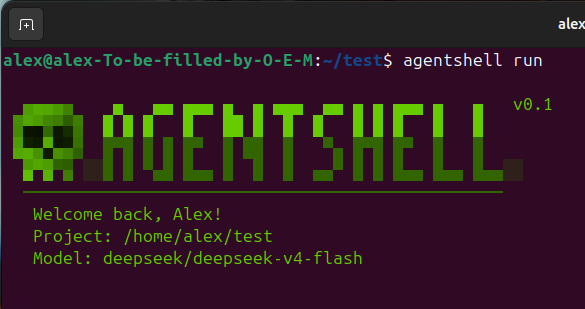

<p align="center">
  
  
  
  
</p>

# Agent Shell

**A terminal agent in four layers.** One Python process, one project folder, no services.



---

The model decides *what* to do. The code decides *what is allowed*. Everything else is
plumbing, and there is very little of it: the whole thing is small enough to read in an
evening and change without archaeology.

> **Status: frozen (October 2026).**
>
> The core is written and the loop works end to end: bootstrap, transport, model calls,
> tools, policy, command output in the terminal, confirmation before long loops. It is
> also rough and unguarded — commands run without asking first, output is bounded only on
> screen, and there is no secret broker or context manager.
>
> Development stopped because it does not earn its keep: the remaining work is large, and
> the result would still be a less capable version of agents that already exist. The code
> stays published because a working agent in ~1.5k readable lines is useful as a
> reference.
>
> Treat it as a prototype. Do not run it in a repository you do not trust.

## What it is

Agent Shell is a CLI that runs an LLM agent inside your terminal, in your project folder,
under your rules. You type a request. The model answers, and may ask to run a shell
command. The command is checked against a small policy, runs in the project root with a
timeout, and the result goes back to the model. This repeats until the model answers with
plain text.

Practical consequences:

- It works on your real files, with your real toolchain, in your real shell.
- It works with any model LiteLLM can reach: DeepSeek, Anthropic, OpenAI, Gemini, Grok.
- Nothing leaves the machine except the prompts you send to the provider.

## What it is not

- **Not a Claude Code competitor.** Different goal, different scale.
- **Not maintained.** Frozen as of October 2026; see [Status & roadmap](#status--roadmap).
- **Not production-grade.** Single user, single process, no telemetry to reconcile.
- **Not a sandbox.** The policy gate reduces accidents; it does not contain a determined
  model. See [Security model](#security-model).
- **Not a service.** No daemon, no Docker, no database. A process and some files.

## Principles

1. **Four layers, one direction.** L0 → L1 → L2 → L3. Nothing below imports upward.
   Dependencies are passed down as arguments, never reached for with an import.
2. **The model thinks, the code guards.** A tool call is a request, not an order.
   Every call is classified before it runs.
3. **Local-first.** A Python process, a `.agentshell/` folder, a log file. That's the
   entire runtime.
4. **Transparent.** You see every command the agent wants to run, before it runs.
5. **Provider-agnostic.** Cheap models by default, expensive ones when a task earns them.
6. **Hackable.** One concern per module, explicit names, no framework, no magic.

## How it works

The agent is a cycle. L2 drives it; L3 serves it.

```
┌──────────────────────────────────────────────────────────────┐
│  L1 · Transport                                              │
│  terminal (now) · telegram · web (later)                     │
│  in: text      out: render()      channel: ask()             │
└───────────────────────────┬──────────────────────────────────┘
                            │ text / ask
┌───────────────────────────▼──────────────────────────────────┐
│  L2 · Core                                                   │
│  messages · system prompt · model call · tool_call parsing   │
│  the cycle and its budget live here                          │
└───────────────────────────┬──────────────────────────────────┘
                            │ tool_call
┌───────────────────────────▼──────────────────────────────────┐
│  L3 · Tools                                                  │
│  run_command · ask_user · memory_*                           │
│  ┌────────┬───────────────┬─────────────────┬─────────────┐  │
│  │ Policy │ Secret Broker │ Context Manager │ Memory      │  │
│  └────────┴───────────────┴─────────────────┴─────────────┘  │
└───────────────────────────┬──────────────────────────────────┘
                            │ ToolResult → back to L2
```

L0 sits above all of this. It runs once at startup, produces the project root and the
config, and then takes no part in the cycle.

### The cycle

1. **L1** reads a line. Local commands (`/help`, `/clear`, `/exit`) are handled here and
   never reach the core.
2. **L1** hands the text to **L2**.
3. **L2** appends the user message, asks L3 to fit the history into the context budget,
   and calls the model with the tool schemas registered in L3.
4. The model answers in one of three shapes:
   - **text only** — the turn is over, L1 renders the answer;
   - **text + tool calls** — the text is rendered, and the cycle continues;
   - **tool calls only** — nothing to render yet, the cycle continues.

   `reasoning_content` is shown as a dim block when the provider returns it.
5. **L2** hands each tool call to **L3**. L1 shows the call before it runs, L3 classifies
   it and executes it, L1 shows the bounded result. L2 appends it as a tool message and
   goes back to step 3.
6. After `max_iterations` iterations **L2** asks L1 to confirm continuing. "Yes" resets
   the budget and the cycle goes on; "no" ends the turn. The conversation stays intact
   for the next one.

The apparent recursion L2 → L3 → L2 is a loop owned by L2. **L3 never calls L2** — it
returns a value, and returning to step 3 is L2's decision. This keeps the dependency
direction one-way and makes tools testable without a model.

### One request, end to end

```
You:  why is the build failing?

L2 → model(system + CLAUDE.md + history + tool schemas)
model → run_command {"command": "cargo build 2>&1 | tail -40"}

L3 → Policy:  ALLOW — read-only, inside the project root
     Broker:  no placeholders, nothing to inject
     Exec:    cwd = project root, timeout 30 s, output bounded
     Post:    redact secrets, fit into the output limit

L2 ← ToolResult(exit 101, "error[E0308]: mismatched types …")
L2 → model again, now with the compiler output

model → "Line 42 returns String where &str is expected …"
L1 renders the answer. Turn over.
```

## Layers

Every layer has one job, one interface, and a list of things it is not allowed to know.

### L0 · Bootstrap

Runs once, before anything else.

- Finds the project root by walking up from the working directory until it sees
  `.agentshell/`. `--project` overrides the start. The home directory is never a project
  root: `~/.agentshell` is the global config directory, not a project marker.
- Creates the project skeleton — explicitly on `init`, leniently on `run`.
- Merges config: `~/.agentshell/config.json` underneath, `<project>/.agentshell/config.json`
  on top. The project wins.
- Configures the file logger.
- Produces `(root: Path, config: dict)` and exits the story.

**Rules.** It decides whether the project exists *before* it writes anything into it.
It knows nothing about models, tools, or the loop.

### L1 · Transport

The only place that touches a human.

- Reads input, renders output, intercepts local slash commands.
- Renders every tool call **before** it runs — name and the command itself — and the
  result after it, bounded for the terminal so a huge build log does not flood the screen.
- Owns the **`ask()` channel**: `ask(text, options) -> str`.
- Knows: text, rendering, terminal state.
- Doesn't know: models, tools, policy, messages.

`ask()` is the single human-in-the-loop primitive. Three consumers use it and none of
them import the transport:

| Consumer | Question |
|---|---|
| L2 iteration budget | "50 iterations. Continue?" |
| Policy, `ASK` decision | "Run `rm -rf build`?" |
| `ask_user` tool | whatever the model needs to know |

The callable is passed down from L1 at startup. That is why L2 and L3 can stop and ask
without knowing whether the human is in a terminal, a Telegram chat, or a web page.

Files: `transport/terminal.py`, `transport/ui.py`.

### L2 · Core

The brain, and the owner of the conversation.

- Owns `messages` and the system prompt (`CLAUDE.md` + project rules).
- Asks L3 for the tool schemas and for a context fit before every model call.
- Calls the model through LiteLLM, parses the response, drives the cycle.
- Enforces the iteration budget.
- Knows: the model, the history, the tools' *schemas*.
- Never prints, never runs a command, never touches a file, never formats tool output.

**Failure rule.** Provider and network errors go up to L1 as errors and are rendered as
errors. They never come back as fake model text.

File: `core/llm.py`.

### L3 · Tools

The hands, and the guards around them.

- Owns the **tool registry**: name → JSON schema + executor.
- Exposes exactly one method to L2:
  `execute(tool_call) -> ToolResult(status, stdout, stderr, exit_code, truncated)`.
- Runs every call through the subsystems below.
- Knows: commands, files, policy, secrets, budgets.
- Doesn't know: L2, messages, models. `cwd`, `ask` and limits are injected.

Two different things live in this layer, and the difference matters:

| | What it is | Who invokes it |
|---|---|---|
| **Tools** | `run_command`, `ask_user`, `memory_*` | the model, via `tool_calls` |
| **Subsystems** | Policy, Secret Broker, Context Manager, Memory | the code, around every call |

A subsystem is not callable by the model. The model cannot ask to skip the policy.

### L3 subsystems

#### Policy — the gate

Classifies each tool call as `ALLOW`, `DENY`, or `ASK`.

- **Default is `ASK`** for anything not explicitly known to be safe. The regex list is a
  complement — an extra reason to say no — not the primary mechanism.
- Returns a decision and a human-readable reason; the reason is shown to the user and
  recorded in the log.
- Runs *before* the command is built, on the parsed call, not on a raw string.

Honest scope: this is a gate against mistakes and against a model that wandered off, not
a security boundary against a model that is trying. A denylist of regular expressions is
trivially bypassed by `sh -c`, `$HOME`, or `curl … | sh`. The real control is the human
in step 6 of the cycle.

#### Secret Broker — the only place secrets exist

- The model sees placeholders: `{{secret:OPENAI_API_KEY}}`, never values.
- Substitution happens at launch time, into the **environment**, never into argv
  (argv is visible in `ps`).
- Every output is **redacted** before it becomes a `ToolResult`, so `env | grep KEY`
  returns nothing useful to the model.
- Credentials come from `~/.agentshell/.env` (trusted). A project `.env` may configure
  the project, but it must not silently replace the user's credentials.

Without the redaction step the broker is decoration: a single `env` call would leak
everything.

#### Context Manager — the budget

Two pure functions, no state of their own:

- `fit(messages, budget) -> messages` — called by L2 before every model call.
- `bound(output, limit) -> str` — called by L3 after every tool call.

Rules: keep the system prompt and the most recent turns; drop the middle, and say so in
the history with an explicit marker, so the model knows something was removed. Bound
output keeps the head and the tail and marks the cut — the middle of a build log is
usually the least interesting part.

Data belongs to L2; only the logic lives here. That is what makes it testable without a
network.

#### Memory — notes, not a database

- `.agentshell/MEMORY.md` is an **index**, and it is always in the system prompt. One
  line per note, cheap enough to keep resident.
- Long-form notes live in `.agentshell/memory/` and are read **on demand** through
  tools (`memory_search`, `memory_read`, `memory_write`).
- Writing a note is a tool call like any other, so it goes through Policy.

The point of the split is cost: the index costs a few dozen tokens, the notes cost
nothing until they are needed.

## On disk

```
your-project/
├── .agentshell/
│   ├── config.json      model, budget, provider
│   ├── CLAUDE.md        project rules, injected into the system prompt
│   ├── MEMORY.md        index of notes, always in the system prompt
│   ├── memory/          long-form notes, loaded on demand
│   └── logs/
│       └── agent.log    every command, decision and error
└── … your code
```

The repository:

```
agentsh/
├── agentshell/
│   ├── main.py          wiring only: argv → L0 → L1 → L2 → L3
│   ├── settings.py      paths, defaults, providers
│   ├── bootstrap/       L0 — project detection, skeleton, config
│   ├── transport/       L1 — terminal, UI
│   ├── core/            L2 — model calls, history, cycle
│   ├── tools/           L3 — run_command, subsystems/
│   └── utils/           logger
├── install.sh
└── requirements.txt
```

## Install

```bash
git clone git@github.com:shliamb/agentsh.git
cd agentsh
./install.sh
```

The installer creates `.venv/`, installs dependencies, and puts `agentsh` and
`agentshell` wrappers in `~/.local/bin`.

## Usage

```bash
cd ~/my-project
agentshell init          # create the .agentshell/ skeleton
agentshell setup-keys    # store API keys in ~/.agentshell/.env
agentshell run           # start the agent (this is the default command)
agentshell --version
```

Inside a session:

| Command | Effect |
|---|---|
| `/help` | list local commands |
| `/clear` | clear the screen |
| `/exit`, `/quit` | end the session |
| `Ctrl+C` once | cancel the current input |
| `Ctrl+C` twice | exit |

## Configuration

`<project>/.agentshell/config.json`, merged on top of `~/.agentshell/config.json`:

```json
{
  "model": "deepseek/deepseek-v4-flash",
  "default_provider": "deepseek",
  "max_iterations": 50
}
```

`max_iterations` is not a hard stop. When the budget runs out the agent asks whether to
continue — long tasks are allowed, they just cost a keystroke.

Keys are configured once and stored outside the project:

```bash
agentshell setup-keys
```

Supported providers are listed in `settings.py`; any LiteLLM model string works, as long
as the matching key is present.

## Security model

Being precise about this matters more than the feature list — especially because the
project is frozen in a state where most of the controls described elsewhere do not exist
yet.

**What is true today**

- **The agent runs shell commands.** Anything the model can be argued into running, it
  will run, with your permissions.
- **There is no confirmation prompt.** A command is executed as soon as the model asks,
  unless one of the seven regex rules in `policy.py` matches: `rm -rf /`, `rm -rf ~`,
  `.env`, `.ssh`, `.aws`, `.pem`, `id_rsa`. That list guards against accidents, not
  attackers — it is bypassed by `$HOME`, `sh -c`, or `curl … | sh`.
- **`~/.agentshell/.env` is loaded into the process.** Any command can print it with
  `env`. There is no secret broker and no output redaction.
- **The project is input.** Files in the repository — READMEs, issues, commit messages,
  test fixtures — can carry instructions. A repository you did not write is untrusted
  input, exactly like a web page.

Practical advice: run it only in a project you own, on a machine where you can afford a
mistake. Use a dedicated API key with a spending limit, and revoke it when you are done.

The design called for more than this — a confirmation gate on every non-trivial call, a
broker that substitutes secrets at launch and redacts them from output, and a policy that
defaults to asking. Those are on the roadmap and not implemented.

## Status & roadmap

**Frozen.** The core is complete and the loop works; no further development is planned.
The checklists below are a record of what is done and what was left, so that anyone
picking the project up knows where the edges are.

Nothing here is half-written code: what is marked `[x]` works and was tested by hand;
what is marked `[ ]` was designed but never written.

### Why it is frozen

It runs, and it is honest about what it does. But it does not solve a problem better than
the agents that already exist — they are faster, safer, and have a team behind them. The
distance between "works on my machine" and "safe to point at a real repository" is a
confirmation gate, a sandbox, context compaction and a memory model: a product-sized
effort, not a weekend one. Freezing it was cheaper than pretending otherwise.

If someone wants to continue, start with the confirmation gate wired to `ask()` — it is
the difference between a demo that runs your shell and a tool you can leave running.

### L0 · Bootstrap

- [x] project detection, skeleton, config merge, file logger
- [x] `init` no longer collides with the logger's directory creation
- [x] `setup-keys` runs from the installer path
- [x] `~/.agentshell` is never mistaken for a project root

### L1 · Transport

- [x] terminal loop, local commands, `Ctrl+C` handling, rendering
- [x] every tool call and its result shown in the terminal
- [x] timing per request and per session
- [x] `ask()` channel — used by the iteration budget
- [ ] streaming output
- [ ] `telegram.py` / `web.py` behind the same interface

### L2 · Core

- [x] LiteLLM call, tool-call parsing, reasoning display
- [x] history kept per session, error recovery
- [x] iteration budget: asks before running away
- [ ] context-fit hook before each call
- [ ] token and cost accounting
- [ ] typed errors instead of a synthetic response

### L3 · Tools

- [x] `run_command` with timeout and structured result
- [x] regex policy with `ALLOW` / `DENY` / `ASK`
- [x] `cwd` pinned to the project root
- [ ] confirmation gate wired to `ask()`
- [ ] tool registry inside L3 (schemas currently live in L2)
- [ ] bounded output (head + tail)
- [ ] secret broker with placeholders and redaction
- [ ] context manager (`fit`, `bound`)
- [ ] memory tools and index injection
- [ ] parallel tool calls
- [ ] sub-agents: L2/L3 as a reusable unit

## Extending it

**A new tool** is three things: a JSON schema, an executor, and a policy entry. Register
it in L3; L2 picks the schema up automatically.

**A new subsystem** (a guard around every call) lives in `tools/subsystems/` and is
wired into `execute()`; it never becomes callable by the model.

**A new transport** touches L1 only: implement input, `render`, and `ask`. Nothing below
changes.

**Never**: import upward, print from L2 or L3, trust a tool call, or let a secret reach a
prompt.

## Non-goals

- Replacing Claude Code or Cursor.
- Supporting every provider feature.
- Multi-user, teams, enterprise.
- A daemon, a database, or a Docker image.
- Being clever. The whole design fits in this file.
- A plugin marketplace.

## License

MIT.
